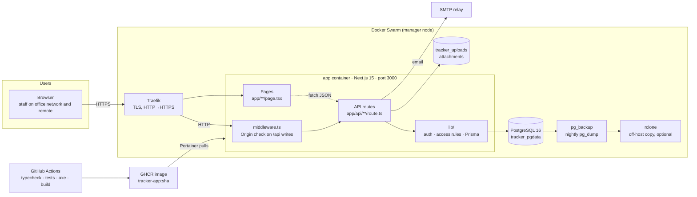
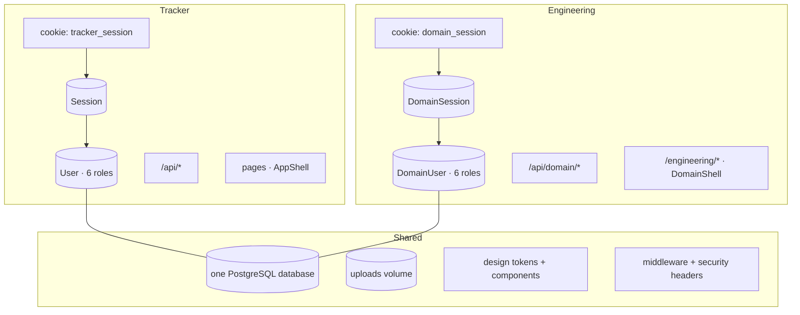
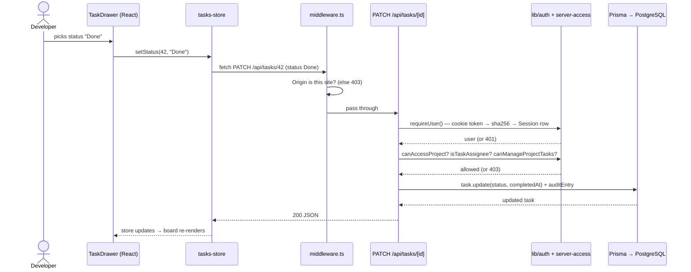
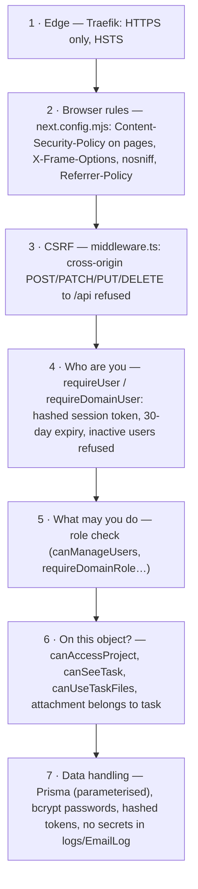
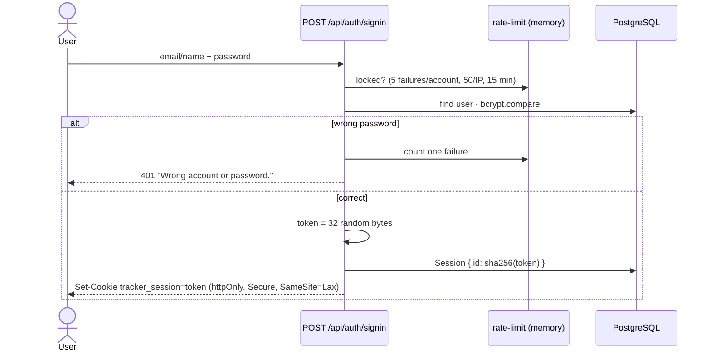
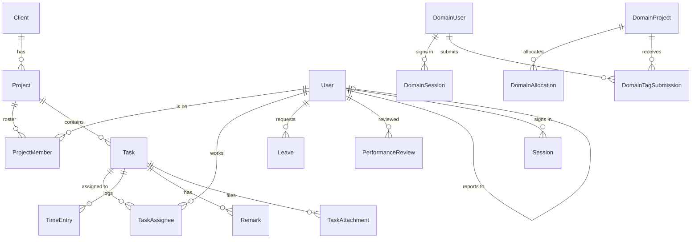
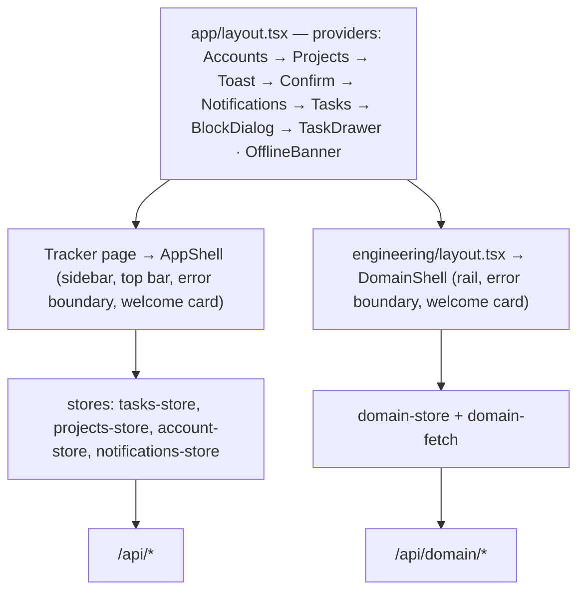
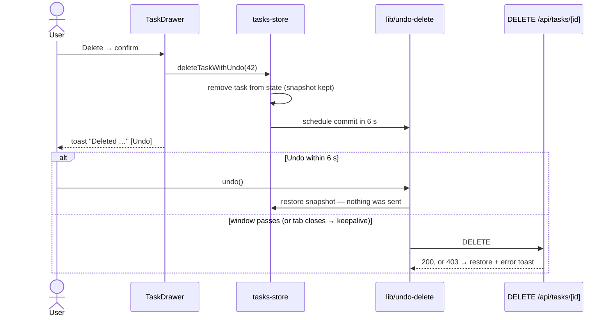
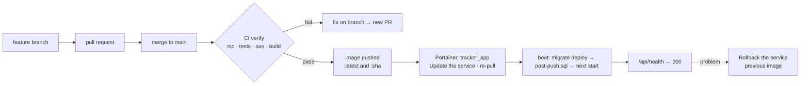

# Architecture guide

How the Inventive Task Manager is built, how its parts are kept apart, and what happens — layer by layer — when you change something. Read this first; the numbered files in `docs/` and `specs/` go deeper on each area.

## The app in one paragraph

One Next.js 15 application (in `demo/`) serves two products that share a database but nothing else a user can see: **Tracker** (projects, tasks, time, leaves, performance reviews, resourcing) and **Engineering** (tag allocations, submissions, approvals, forecast, KPIs — called *domain* in the code). Pages are React client components that load data from the app's own JSON API (`app/api/**/route.ts`). Every API route checks a cookie session on the server, then a role, then that the specific object belongs to something the user may touch. Data lives in PostgreSQL through Prisma. Production is a Docker Swarm stack behind Traefik; GitHub Actions tests every merge to `main` and publishes the image that Portainer deploys.

## System at a glance



| Layer | Technology | Where |
| --- | --- | --- |
| Edge | Traefik (shared with other apps), Let's Encrypt | outside the repo; routed by labels in `compose.yml` |
| App | Next.js 15 App Router, React 19, TypeScript | `demo/` |
| Data | PostgreSQL 16, Prisma 6 | `demo/prisma/` |
| Files | Docker volume mounted at `/uploads` | `UPLOAD_DIR` |
| Email | nodemailer over SMTP; every message also written to `EmailLog` | `demo/lib/mailer.ts` |
| CI/CD | GitHub Actions → GHCR → Portainer | `.github/workflows/build-app.yml`, `compose.yml` |

## How the code is organised

```
demo/
├── app/                      pages (Tracker at the root, Engineering under engineering/)
│   ├── layout.tsx            providers for the whole app (accounts, projects, toasts, tasks, drawer…)
│   ├── my-day/ projects/ …   Tracker pages — each renders inside <AppShell>
│   ├── engineering/          Engineering pages — layout.tsx wraps them in <DomainShell>
│   └── api/
│       ├── auth/ tasks/ …    Tracker API (requireUser)
│       └── domain/           Engineering API (requireDomainUser)
├── components/               shared UI: AppShell, DomainShell, TaskDrawer, Skeleton, Toast, WelcomeCard…
├── lib/
│   ├── auth.ts               Tracker sign-in, sessions, passwords
│   ├── domain-auth.ts        Engineering sign-in, sessions
│   ├── server-access.ts      Tracker permission helpers (who may see/do what)
│   ├── access.ts             client-side page map per role (hides UI only)
│   ├── domain.ts             Engineering role lists
│   ├── *-store.tsx           client state per area (tasks, projects, accounts, notifications)
│   ├── design-tokens.ts      every colour, width and motion value
│   └── session-token.ts, client-ip.ts, csrf.ts, setup-token.ts, rate-limit.ts   security building blocks
├── middleware.ts             refuses cross-origin writes to /api/*
├── prisma/                   schema.prisma, migrations/, seed.ts, post-push.sql
├── scripts/                  one-off maintenance (run with npx tsx)
└── __tests__/                Vitest: unit, route permission, accessibility, design rules
```

**Rule of thumb:** pages and components decide what to *show*; `lib/server-access.ts` (Tracker) and `lib/domain*.ts` (Engineering) decide what is *allowed*; API routes glue the two and are the only code that touches the database on behalf of a user.

## Two modules, kept apart



| | Tracker | Engineering |
| --- | --- | --- |
| Sign-in | `/login` → Tracker tab → `POST /api/auth/signin` | `/login` → Engineering tab → `POST /api/domain/auth/signin` |
| Cookie / session table | `tracker_session` / `Session` | `domain_session` / `DomainSession` |
| Users | `User` — Admin, Lead, Coordinator, HR, BusinessDeveloper, Developer | `DomainUser` — Admin, CEO, Lead, TeamLead, SME, Actionee |
| API guard | `requireUser()` + helpers in `lib/server-access.ts` | `requireDomainUser()` + `requireDomainRole()` with lists in `lib/domain.ts` |
| Tables | `Project`, `Task`, `TimeEntry`, `Leave`, `PerformanceReview`, … | every table prefixed `Domain` |
| Shell | `components/AppShell.tsx` | `components/DomainShell.tsx` |
| Files on disk | `/uploads/<taskId>/…` | `/uploads/domain/<taskId>/…` |

Signing in to one module does nothing for the other. A person can have an account in each, with different roles.

## Life of a request

Worked example: a Developer opens a task and marks it **Done**.



What each hop is responsible for:

1. **Component** (`components/TaskDrawer.tsx`) — shows only controls the role can use, but never relies on that for safety.
2. **Store** (`lib/tasks-store.tsx`) — one place that calls the API and updates shared state, so every page showing the task changes together.
3. **Middleware** (`middleware.ts` → `lib/csrf.ts`) — a write from another origin is refused before any app code runs.
4. **Route** (`app/api/tasks/[id]/route.ts`) — parses input, asks the permission helpers, writes, records the audit entry.
5. **Auth** (`lib/auth.ts`) — turns the cookie into a user. The database only holds the token's SHA-256.
6. **Permission helpers** (`lib/server-access.ts`) — role *and* object checks: is this task on a project the user can reach; are they its assignee or the project's lead/co-ordinator.
7. **Prisma** — the only way to the database; no raw SQL except the sequence realignment in the backup restore.

## Security architecture

Defence in layers — each one assumes the one before it can fail.



### Sign-in and sessions



| Concern | How it's handled | Code |
| --- | --- | --- |
| Passwords | bcrypt; 10+ chars with a letter and a digit/symbol | `lib/auth.ts` `passwordIssue` |
| Sessions | random 256-bit token in cookie, SHA-256 in DB; any password change ends other sessions | `lib/session-token.ts`, `lib/auth.ts` |
| Brute force | failures only, per account and per IP; IP = right-most `X-Forwarded-For` hop | `lib/rate-limit.ts`, `lib/client-ip.ts` |
| Password reset | 256-bit single-use token, 60 min, stored hashed; link kept out of the EmailLog once SMTP delivers | `app/api/auth/forgot-password`, `reset-password` |
| First admin | allowed only while a module has no users; `SETUP_TOKEN` if set | `lib/setup-token.ts` |
| CSRF | SameSite=Lax cookie + Origin check | `middleware.ts`, `lib/csrf.ts` |
| XSS | React escaping + CSP (`script-src 'self' 'unsafe-inline'`, `object-src 'none'`, `frame-ancestors 'self'`) | `next.config.mjs` |
| Uploads | 25 MB cap, random stored name, path cleaned, served as download | `app/api/tasks/[id]/attachments/*` |
| Spreadsheets | SheetJS 0.20.3 from its CDN (the npm 0.18 has CVEs) | `app/api/import`, `projects/[id]/import-tasks` |
| Backups | JSON export omits password hashes unless ticked | `lib/backup-tables.ts`, `app/api/admin/backup` |

## Data model



38 models in total (20 Tracker, 18 Engineering) — the full list with columns is in [specs/05-data-model.md](../specs/05-data-model.md). Migrations are additive; a data-changing migration must be safe to run twice.

## UI architecture



Every screen handles the same set of states with the same components:

| State | Component | Example |
| --- | --- | --- |
| Loading | `PageSkeleton`, `CardSkeleton`, `ListSkeleton` | project page while data loads |
| Empty | `EmptyState` | "No projects yet" |
| Error | `SectionErrorBoundary` | one chart fails, the dashboard stays |
| Offline | `OfflineBanner` | "You're offline. Changes you make now won't be saved…" |
| Delete | `useConfirm()` → toast with **Undo** | task deleted; request sent after 6 s |
| First visit | `WelcomeCard` | three tips on the role's landing page |

Styling comes only from `lib/design-tokens.ts` through Tailwind (`brand-*`, `ink-*`, `max-w-container*`, motion). Text is 12 px minimum, text colours are ≥ 4.5:1, icon buttons have `aria-label` + `tap-target`. Details: [docs/design-system.md](./design-system.md).

### Example: deleting a task with Undo



## Making changes — what the flow looks like

Each recipe lists every place the change touches, in order. CI runs the same checks on every merge to `main`.

### Recipe 1 · A new Tracker API endpoint

*Example: Leads and Co-ordinators can put a project on hold — `POST /api/projects/[id]/hold`.*

1. **Route** — `demo/app/api/projects/[id]/hold/route.ts`. Export only HTTP handlers (Next fails the build on other exports); helpers go in `lib/`.

   ```ts
   import { NextResponse } from "next/server";
   import { prisma } from "@/lib/db";
   import { canAccessProject, canManageProjectTasks, requireUser, writeAudit } from "@/lib/server-access";

   export async function POST(_req: Request, context: { params: Promise<{ id: string }> }) {
     const userOrResp = await requireUser();            // 401 when signed out
     if (userOrResp instanceof NextResponse) return userOrResp;
     const user = userOrResp;
     const id = Number((await context.params).id);
     if (!Number.isFinite(id)) return NextResponse.json({ error: "Invalid id" }, { status: 400 });
     // role AND object: can reach this project, and runs it
     if (!(await canAccessProject(user, id)) || !(await canManageProjectTasks(user, id))) {
       return NextResponse.json({ error: "Forbidden" }, { status: 403 });
     }
     const project = await prisma.project.update({ where: { id }, data: { status: "On Hold" } });
     await writeAudit(user.id, "project.hold", { scope: project.name });
     return NextResponse.json({ ok: true });
   }
   ```

2. **Permission rule** — reuse a helper from `lib/server-access.ts`; add a new one there (not in the route) if the rule is new, so pages and other routes share it.
3. **Store** — add `holdProject(id)` to `lib/projects-store.tsx`; components call the store, never `fetch` directly.
4. **UI** — a button where it belongs, shown only to the roles the server allows (`lib/access.ts` for page-level rules).
5. **Tests** — `demo/__tests__/project-hold-route.test.ts`: signed out → 401, Developer → 403, project they can't reach → 403, Lead on the project → 200 and audit written. Mock `@/lib/db` and `@/lib/server-access` as in `attachments-route.test.ts`.
6. **Docs** — add the route to [specs/06-api-spec.md](../specs/06-api-spec.md) and the rule to [docs/02-roles-and-permissions.md](./02-roles-and-permissions.md).
7. **Ship** — PR → merge → CI (typecheck, tests, axe, build) → image → deploy (Recipe 6).

### Recipe 2 · A new page

*Example: an Admin-only `/reports` page.*

1. `demo/app/reports/page.tsx` — a client component wrapped in `<AppShell>`, width `max-w-container`.
2. `demo/lib/access.ts` — add `"/reports"` to the roles that may open it (AppShell redirects everyone else).
3. `demo/components/AppShell.tsx` — add it to `NAV` for those roles (keep the existing order; don't rename items).
4. States — `PageSkeleton` while loading, `EmptyState` when there's nothing, data fetched through a store; the API behind it follows Recipe 1.
5. Design — tokens only (no hex, no `text-[11px]`), grids start `grid-cols-1`, tables sit in `overflow-x-auto`, labels tied to inputs.
6. Tests — any new shared component goes into `__tests__/a11y.test.tsx`; `design-tokens.test.ts` already scans the new file.
7. Docs — a row in [docs/04-screens.md](./04-screens.md).

### Recipe 3 · A new database column or table

*Example: `Task.archivedAt`.*

1. `demo/prisma/schema.prisma` — `archivedAt DateTime?` (nullable or defaulted, so existing rows stay valid).
2. Migration — `npx prisma migrate dev --name task_archived_at` locally against Postgres; commit the folder in `prisma/migrations/`. It runs automatically on boot (`prisma migrate deploy`).
3. Serializer — expose it in `lib/serializers.ts` if the UI needs it.
4. Backup — nothing to do: `lib/backup-tables.ts` reads the schema, and a test checks every table is covered.
5. Never drop or rename in place; never make the seed touch a populated database.

### Recipe 4 · A security-sensitive change

*Examples: a new public endpoint, a new upload type, a new secret.*

| If you add… | Then also… |
| --- | --- |
| A public route (no session) | rate-limit it (`lib/rate-limit.ts` + `clientIp`), return generic errors, list it under "Public endpoints" in specs/06 |
| A route that takes an id | check the object belongs to the parent you authorised (the attachment-delete bug was exactly this) |
| A file upload | size cap, server-chosen file name, serve as `attachment`, check task/project access |
| A token or secret | store only a hash; never log it or put it in `EmailLog`; env var in `compose.yml` + `.env.example` |
| A new role | update `lib/access.ts`, the server helpers and docs/02 together |
| A dependency | it must support Node 20 (CI and production) — check `engines` in its `package.json` |

### Recipe 5 · An Engineering-module change

Same as Recipe 1, but under `app/api/domain/`, guarded by `requireDomainUser()` and `requireDomainRole(user, SUPERVISOR_ROLES)` (role lists in `lib/domain.ts`), with tables prefixed `Domain` and pages under `app/engineering/`. The rail entry goes in `NAV` inside `components/DomainShell.tsx`, which reuses the same role constants as the API so a link never leads to a 403.

### Recipe 6 · Releasing and rolling back



- CI runs only after a merge to `main`; a failing check means **no image** is published, so production is untouched.
- Rolling back to the previous image is safe because migrations are additive. Exception noted in [specs/08-deployment.md](../specs/08-deployment.md): an image older than the session-hash migration signs everyone out once.

## Conventions and gotchas

- **Node 20.** CI and the production image run Node 20; local machines may run newer. Don't use Node 22+ APIs (`fs.globSync` broke CI once) or dependencies that require them (jsdom 31 did).
- **Route files export only handlers.** Put helpers in `lib/`.
- **HR = Co-ordinator** for access checks (`lib/role-access.ts`); the real role is kept for HR-only privileges.
- **Sign-in accepts a first name** as well as an email (Tracker).
- **Rate limits and lockouts live in memory** — correct for one app container; move to Redis before running more replicas.
- **Line endings** are CRLF in the Windows working copy (`core.autocrlf=true`).
- **Seed data** — `prisma/seed.ts` only fills an empty database; demo password `tracker2026`.
- **Tests** mock `@/lib/db` and the auth helpers; follow an existing `*-route.test.ts` file.

## Where to read next

| Topic | File |
| --- | --- |
| Roles and permissions | [docs/02-roles-and-permissions.md](./02-roles-and-permissions.md) |
| Every screen | [docs/04-screens.md](./04-screens.md) |
| Design system | [docs/design-system.md](./design-system.md) |
| All tables | [specs/05-data-model.md](../specs/05-data-model.md) |
| Every API route and its guard | [specs/06-api-spec.md](../specs/06-api-spec.md) |
| Deployment and backups | [specs/08-deployment.md](../specs/08-deployment.md) |
| Definition of done | [specs/10-acceptance-criteria.md](../specs/10-acceptance-criteria.md) |
